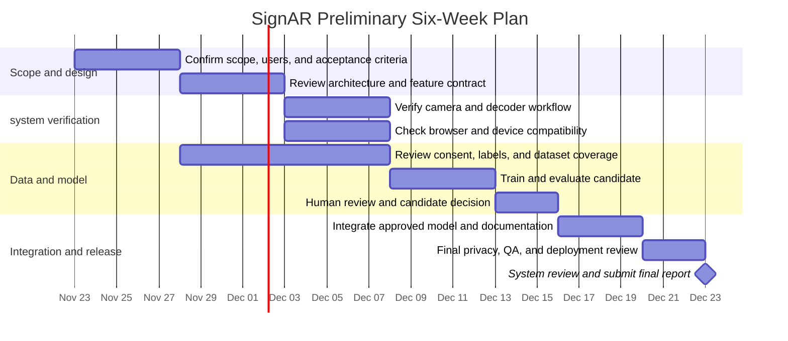

# Preliminary Timeline

The schedule below is a relative six-week plan. Replace Week 1 with the group's approved start date and adjust durations to actual course deadlines and contributor availability. Work can overlap where dependencies permit; model promotion and release sign-off remain gated on evaluation and review.

## Gantt chart

**Date note:** This is an editable planning example beginning 23 November 2026, not a confirmed course calendar. Shift all dates together after the group confirms its start date. The exact timeline should be maintained in one source of truth to avoid a diagram/report mismatch.

## Milestones and owners

| Milestone | Target | Lead | Evidence / exit criterion |
|---|---|---|---|
| M1: Scope frozen | End of Week 1 | Project direction lead | Section 3 and user-story scope agreed; limitations stated. |
| M2: Architecture and contract reviewed | End of Week 2 | Architecture lead | Holistic-v4 data flow, legacy hand-v3 compatibility, and vocabulary boundary reviewed. |
| M3: Browser workflow verified | End of Week 3 | Decoder lead and validation lead | Camera, tracking, prediction/reject, and error paths checked. |
| M4: Dataset ready for evaluation | End of Week 4 | Data owner | Consent and label review complete; coverage and privacy checks recorded. |
| M5: Candidate decision | End of Week 5 | Model owner and validation lead | Evaluation reviewed; candidate promoted, deferred, or rejected with reasons. |
| M6: Release-ready report and system review | End of Week 6 | Timeline lead coordinates; all contributors review | Deployment boundary, documentation consistency, and QA checklist signed off. |

## Dependencies and contingency

The final model decision depends on dataset readiness, a stable feature contract, evaluation, and human review. If additional data collection is delayed, preserve the current tested model only if its provenance and compatibility are confirmed, and clearly mark camera-unverified classes. Do not compress privacy, consent, label review, or compatibility checks to meet a date. If the schedule must shrink, reduce optional UI polish and nonessential report formatting before reducing evaluation or release checks.
